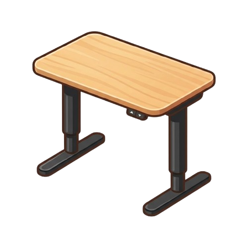

<p align="center">
  
</p>

<h1 align="center">bekant</h1>

<p align="center">
  <strong>A desk for every project.</strong> Windows virtual desktops, set up and cleaned up for you.
</p>

---

## What it does

### `bekant <path>`: open a project

Creates a new virtual desktop named after the folder, switches to it, and opens:

- **Zed** with the project (`zed -n <path>`)
- a new **Firefox** window

Then it waits (up to 15 s) for each app's new window, moves it to the new desktop in case it
opened elsewhere, and places it in your FancyZones layout: Zed in zones 3–6, Firefox in zone 2.
The apps are started detached, so closing the terminal doesn't close them.

### `bekant watch`: clean up closed desktops

Runs in the foreground and watches for virtual desktops being closed (for example with the
scroll wheel in the Win+Tab overview). When one is closed, it finds the windows that were on it:

| Mode | What happens |
| --- | --- |
| `bekant watch` | Dry run: prints which windows it would close. |
| `bekant watch --close` | Asks each of those windows to close, like clicking its × button. |

Windows are left alone if they're pinned to all desktops, have a dialog open, or were moved to
another desktop. Apps can still ask about unsaved work.

## Usage

```powershell
bekant Z:\source\oBusk\example   # desktop named "example"
bekant .                         # the current folder
bekant watch                     # dry run
bekant watch --close             # close windows from closed desktops
```

Running `bekant <path>` twice creates two desktops.

## Requirements

- **Windows 11 24H2**, build 26100.2605 or newer (required by
  [`winvd`](https://crates.io/crates/winvd), which drives the undocumented virtual desktop API)
- [**Zed**](https://zed.dev) with `zed` on `PATH`
- **Firefox** at `C:\Program Files\Mozilla Firefox\firefox.exe`
- [**PowerToys FancyZones**](https://learn.microsoft.com/windows/powertoys/fancyzones) with a
  custom grid layout (without spacing) as the default layout

## Build

```powershell
cargo build --release
```

Build with the Windows toolchain (`x86_64-pc-windows-msvc`), not from WSL.

## How it works

<details>
<summary>Window placement</summary>

Zone rectangles are read from FancyZones' own files in
`%LOCALAPPDATA%\Microsoft\PowerToys\FancyZones`. A new desktop gets FancyZones' default layout
for the monitor's orientation, so bekant reads that one. Zed and Firefox hand new windows to an
already running instance, so bekant recognises the new window by its class instead of by the
process it started.

</details>

<details>
<summary>Closing windows</summary>

By the time Windows reports a desktop as closed, it has already moved that desktop's windows to a
neighbouring one. So `bekant watch` records which desktop each window is on once a second, and
looks the closed desktop up in that record. A window opened or moved less than a second before
its desktop is closed may be missed and left open.

</details>

## Status

An early prototype, built for one person's setup: the apps, the Firefox path and the zone
numbers are hardcoded. Configuration comes later.

Note that `bekant watch --close` will also close the terminal it runs in if you close that
terminal's desktop, so run it on a desktop you keep.

## License

[MIT](LICENSE)
